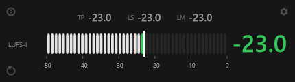
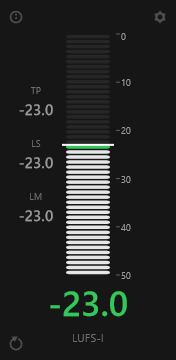
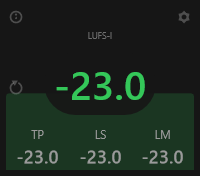

# LUFS Meter

A minimal Windows x64 VST3 plugin that measures **Integrated**, **Momentary** and
**Short-Term Loudness** and **True Peak** according to ITU-R BS.1770 and
EBU R 128, and displays them together with a compact bar scale.

The plugin is a **measurement device**. It never modifies the incoming audio
signal.

> **Status: v1.8.0.** A new measurement pass now visibly starts the meter over
> (the bar empties and fills up to the new value, so a cursor move is
> unmistakable), and the icon buttons are dimmed further. Carries over the
> configurable True Peak warning threshold (−1.0 dBTP by default), the −50 … 0
> LUFS scale, Vertical's 46 px reading, popups that close on any click outside
> them, the per-display-mode window-size memory and the compact layouts
> (176 × 360 / 430 × 120 / 200 × 176). See
> [docs/testing.md](docs/testing.md) for the exact verified state.

## Features

- Integrated Loudness (LUFS-I), rounded to 0.1 LU, with a large focal reading
  coloured by the active zone.
- −50 … 0 LUFS scale with a mark every 10 LU, so typical programme material
  (−14 … −16 LUFS) sits in the upper third of the meter.
- True Peak (TP), Short-Term (LS) and Momentary (LM) numeric readouts,
  subordinate to the Integrated value: a row above the scale in horizontal
  orientation, and stacked two-line groups to the left of the scale in vertical
  orientation. True Peak turns red at a threshold set in the settings
  (**−1.0 dBTP** by default).
- Segmented horizontal / vertical scale with configurable green and red zones.
- The indicator fills up to the first value of a pass over about half a second,
  with the reading travelling with it, instead of jumping to it.
- Three mutually exclusive display modes, chosen in one selector: **Vertical**
  and **Horizontal** (the existing segmented meter) and **Compact**, a nearly
  square digital meter whose background is one continuous fill that rises and
  falls with the Integrated value using the configured zone colours; its focal
  reading sits on a capsule, so the fill's edge passes behind the digits.
- Remembers the window size of **each** display mode in the plug-in state, and
  restores it when the host reopens the window; **Reset window size** in the
  settings popup returns a mode to the size it is designed for.
- About / information popup with the plugin metadata, the measurements and the
  third-party attributions.
- Transport-driven measurement pass: silence during playback never clears the
  value; play-after-stop, seek and loop start a new pass.
- Reset button in the main interface.
- Optional `LUFS-I` label and scale marks.
- Explicit "no valid value yet" state (never a fake `0 LUFS` / `0 dBTP`).
- Non-blocking UI updates.

Out of scope: Loudness Range (LRA), dynamics processing, loudness history
graphs, target levels, extra DSP.

## Screenshots

The three display modes, rendered from the plugin at their preferred sizes:

<table>
  <tr>
    <th align="center">Horizontal (430 × 120)</th>
    <th align="center">Vertical (176 × 360)</th>
    <th align="center">Compact (200 × 176)</th>
  </tr>
  <tr>
    <td align="center"></td>
    <td align="center"></td>
    <td align="center"></td>
  </tr>
</table>

> Rendered offscreen through JUCE at the code's logical sizes (see
> [docs/testing.md](docs/testing.md)); not host screenshots. The minimum size of
> each mode is rendered too (`ui-mode-vertical-min.png`,
> `ui-mode-horizontal-min.png`, `ui-compact-min.png`).

## Plugin identity

| Field | Value |
|---|---|
| Manufacturer | SafroAudio |
| Manufacturer code | `Safr` |
| Plugin code | `Lufs` |
| Bundle identifier | `com.SafroAudio.LUFSMeter` |
| Product version | 1.8.0 |
| Format | VST3, Windows x64 |

## Requirements

- Windows 10/11 x64.
- Visual Studio 2022 Build Tools with the **Desktop development with C++**
  workload (MSVC v143 + Windows SDK).
- CMake >= 3.25, Ninja.
- Git (with submodules).

## Dependencies (pinned)

| Dependency | Version | License | How |
|---|---|---|---|
| [JUCE](https://github.com/juce-framework/JUCE) | 8.0.15 | AGPLv3 / commercial | git submodule `third_party/JUCE` |
| [libebur128](https://github.com/jiixyj/libebur128) | v1.2.6 | MIT | git submodule `third_party/libebur128` |

Exact commits are recorded by the git submodules.

## Getting the sources

```powershell
git clone --recurse-submodules https://github.com/safroigor/LUFS_meter.git
cd LUFS_meter
```

If you already cloned without submodules:

```powershell
git submodule update --init --recursive
```

## Building

The build wrapper imports the MSVC environment (required by Ninja) and then runs
CMake configure + build:

```powershell
powershell -ExecutionPolicy Bypass -File scripts/build.ps1 -Preset release
```

Debug build:

```powershell
powershell -ExecutionPolicy Bypass -File scripts/build.ps1 -Preset debug
```

Run the tests:

```powershell
powershell -ExecutionPolicy Bypass -File scripts/build.ps1 -Preset release -Test
```

Build artefacts:

```
build/release/LUFSMeter_artefacts/Release/VST3/LUFS Meter.vst3
```

## Installing for a host (REAPER)

Copy the produced `LUFS Meter.vst3` bundle to a VST3 folder that your host scans,
for example:

```powershell
Copy-Item -Recurse -Force "build\release\LUFSMeter_artefacts\Release\VST3\LUFS Meter.vst3" `
    "$env:APPDATA\REAPER\..."
```

The exact host scan path is documented and verified in
[docs/development.md](docs/development.md).

## License

The project is released under the **GNU Affero General Public License v3.0**
(see `LICENSE`), which is compatible with the JUCE AGPLv3 option and with
libebur128's MIT license.

## Documentation

- [docs/development.md](docs/development.md) — environment, build, install.
- [docs/architecture.md](docs/architecture.md) — components, data flow, sync.
- [docs/measurement.md](docs/measurement.md) — standard, algorithm, limits.
- [docs/testing.md](docs/testing.md) — test matrix, tolerances, results.
- [docs/decisions/](docs/decisions/) — Architecture Decision Records.
